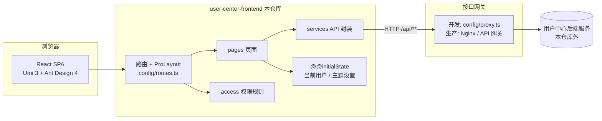
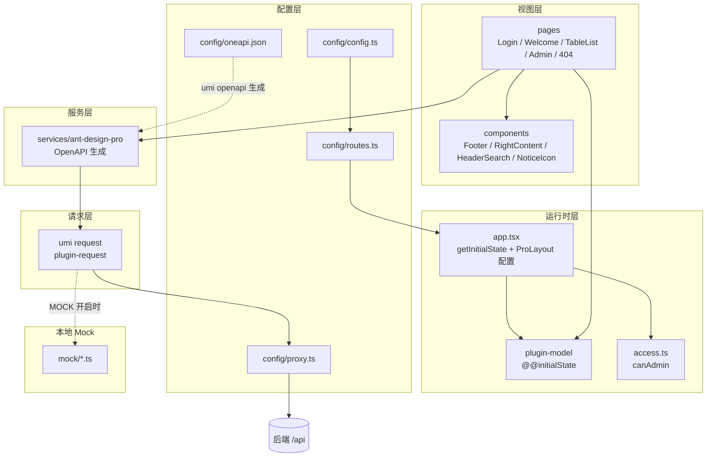
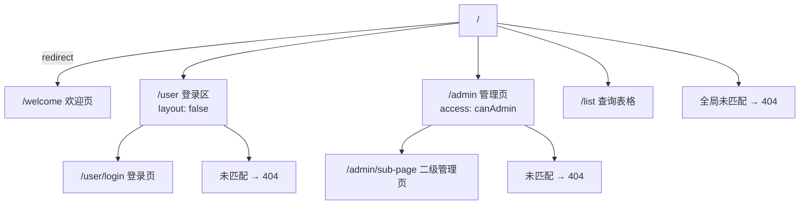
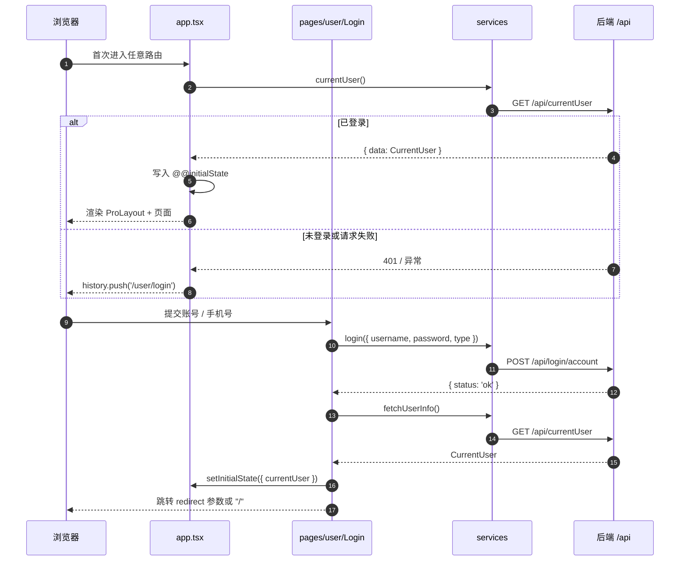
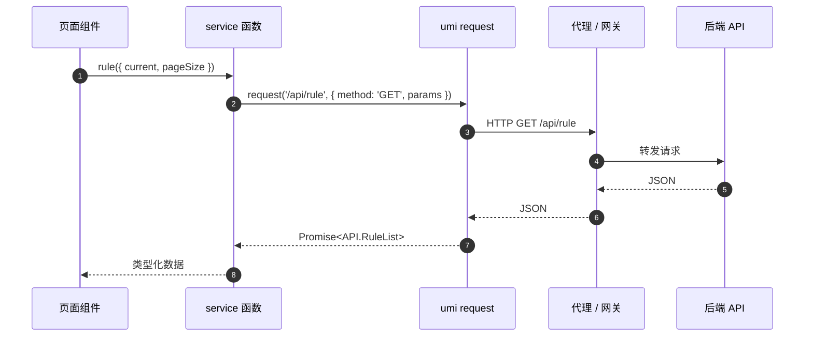
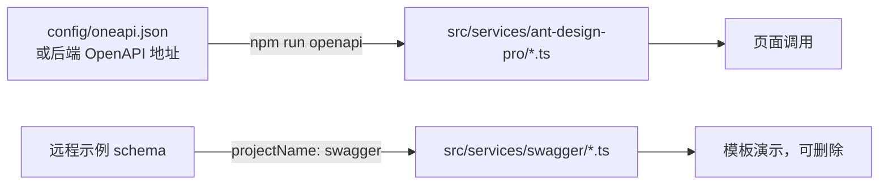
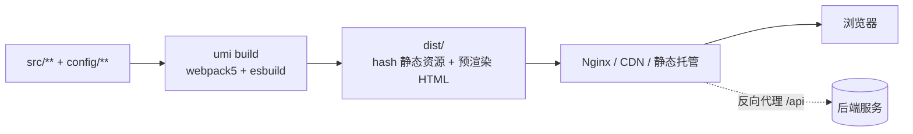

# user-center-frontend 架构说明

> 基线：Ant Design Pro 5.2.0（Umi 3 + React 17 + Ant Design 4）
> 状态：脚手架阶段，当前仅含模板示例页，用户中心业务尚未落地
> 更新日期：2026-11-16

## 1. 项目定位

`user-center-frontend` 是用户中心系统的管理端 Web 前端，基于 Ant Design Pro v5 官方脚手架初始化。当前代码是脚手架的原始状态：欢迎页、查询表格、管理页、登录页均为模板示例，主题、Logo、标题、`package.json` 名称仍是模板默认值。

本文档描述**现存架构**（代码里已经生效的机制），并在最后一节给出接入真实用户中心后端时的演进方向。

## 2. 技术栈

| 分类 | 选型 | 版本 / 说明 |
| --- | --- | --- |
| UI 框架 | React | `^17.0.0` |
| 应用框架 | Umi | `^3.5.0`，配置式路由 + 插件体系 |
| 组件库 | Ant Design | `^4.20.0` |
| 中后台组件 | `@ant-design/pro-components` | `1.1.1`（ProLayout / ProTable / ProForm / LoginForm 等） |
| 语言 | TypeScript | `^4.5.0`，`strict: true` |
| 全局状态 | Umi `plugin-model` | `useModel('@@initialState')`；`dva` 已在配置中开启但无 models |
| 请求 | Umi `plugin-request` | `import { request } from 'umi'` |
| 路由 / 权限 | `plugin-layout` + `plugin-access` | 路由表驱动菜单与权限 |
| 国际化 | `src/locales` | 内置 8 种语言文案，`locale` 插件未显式启用 |
| Mock | Umi Mock（Express 风格） | `mock/*.ts`，默认随 `umi dev` 生效 |
| 构建 | Umi Build | webpack5 + esbuild + MFSU，产物 `dist/` |
| 代码质量 | ESLint(@umijs/fabric) / Prettier / Stylelint | Husky + lint-staged 提交卡点 |
| 测试 | Jest（`umi test`）/ Playwright | 单测与 e2e 冒烟 |
| Node | `>= 12` | 本机为 Node 24 |

## 3. 系统上下文

前端是纯 SPA，所有业务数据通过 `/api/**` 访问后端；开发期由 Umi dev server 代理，生产期依赖网关/反向代理（`config/proxy.ts` 仅对 dev/test/pre 生效）。后端服务不在本仓库内。



## 4. 分层架构

分层与依赖方向：**页面 → services → request → 后端**；页面不直接拼接口 URL，services 不依赖 React。配置层（路由、代理、OpenAPI 契约）只做声明，不承载业务逻辑。



### 各层职责

| 层 | 位置 | 职责 |
| --- | --- | --- |
| 视图层 | `src/pages`、`src/components` | 页面渲染、表单交互、调用 services；通用布局组件不含业务 |
| 运行时层 | `src/app.tsx`、`src/access.ts` | 启动时拉取当前用户、ProLayout 运行时装配、登录守卫、权限规则 |
| 服务层 | `src/services` | 按后端契约封装接口函数与返回类型，供页面调用 |
| 请求层 | Umi `plugin-request` | 统一发起 HTTP 请求；当前无全局拦截器 |
| 配置层 | `config/` | 路由菜单、外观默认值、代理、OpenAPI 生成、构建行为 |
| Mock 层 | `mock/` | 开发期模拟 `/api/**`，与真实后端互斥 |

## 5. 目录结构

```text
user-center-frontend/
├─ config/                 # Umi 配置目录
│  ├─ config.ts            # 主配置：插件、路由、主题、构建、openAPI
│  ├─ config.dev.ts        # UMI_ENV=dev 时叠加（react-dev-inspector）
│  ├─ routes.ts            # 路由 + 菜单 + 权限声明
│  ├─ defaultSettings.ts   # ProLayout 默认外观
│  ├─ proxy.ts             # /api 开发/测试代理
│  └─ oneapi.json          # OpenAPI 3.0 契约（服务生成输入）
├─ mock/                   # 登录、当前用户、rule CRUD、通知等 Mock 接口
├─ public/                 # favicon、logo、PWA 图标、CNAME
├─ src/
│  ├─ app.tsx              # 运行时：getInitialState + layout 配置
│  ├─ access.ts            # 权限规则（canAdmin）
│  ├─ components/          # Footer、RightContent、HeaderSearch、NoticeIcon 等
│  ├─ pages/               # 页面（user/Login、Welcome、TableList、Admin、404）
│  ├─ services/            # API 封装
│  │  ├─ ant-design-pro/   # 由本地 oneapi.json 生成
│  │  └─ swagger/          # 由远程示例 OpenAPI 生成（模板演示）
│  ├─ locales/             # 8 种语言文案（未接入 locale 插件）
│  ├─ e2e/                 # Playwright 冒烟用例
│  ├─ global.tsx/.less     # 全局启动逻辑（PWA/ServiceWorker）与全局样式
│  ├─ manifest.json        # PWA 清单
│  └─ .umi/                # Umi 临时生成目录（勿手改，已 gitignore）
├─ tests/                  # Jest setup + e2e 启动编排
├─ .husky/                 # pre-commit / commit-msg 钩子
├─ package.json            # 脚本、依赖
└─ tsconfig.json           # strict + 路径别名 @ → src、@@ → src/.umi
```

约定：

- `src/.umi` 由 Umi 生成（`umi dev` / `umi g tmp`），不属于源码，禁止手改。
- `src/services/**` 由 OpenAPI 生成，文件头带 `@ts-ignore` / `eslint-disable`，禁止手改，重新生成即可。
- 路径别名：`@/*` → `src/*`，`@@/*` → `src/.umi/*`。

## 6. 路由与菜单

路由由 `config/routes.ts` 集中声明，同一份配置同时驱动 React Router 和 ProLayout 侧边菜单（`name`、`icon` 生成菜单项，`layout: false` 跳过 ProLayout，`access` 绑定权限规则）。



| 路径 | 菜单名 | 组件 | 说明 |
| --- | --- | --- | --- |
| `/user/login` | 登录 | `pages/user/Login` | 独立布局，不经过 ProLayout |
| `/welcome` | 欢迎 | `pages/Welcome` | 登录后默认落地页（`/` 重定向到此） |
| `/list` | 查询表格 | `pages/TableList` | ProTable CRUD 示例，对接 `/api/rule` |
| `/admin` | 管理页 | `pages/Admin` | 需 `canAdmin`，含子路由 `/admin/sub-page` |
| `*` | - | `pages/404` | 兜底 |

菜单标题当前为中文硬编码（`routes.ts` 中的 `name`）。`layout.locale: true` 已配置，但顶层 `locale` 插件未启用，`src/locales` 中的多语言资源暂未生效。

## 7. 登录态、全局状态与权限

### 7.1 启动与登录时序



关键实现：

- `src/app.tsx` 的 `getInitialState()` 在非登录页启动时调用 `currentUser`，拿到 `currentUser` 与默认 `settings`；请求较慢时展示 `PageLoading`。
- `layout` 运行时装配：右侧内容区、页脚、水印（当前用户名）、`SettingDrawer` 主题抽屉，以及 `onPageChange` 中的登录守卫（无 `currentUser` 且不在登录页则跳转登录）。
- 登录成功后先刷新 `currentUser` 再跳转，保证后续页面权限判断可用。

### 7.2 全局状态

- 唯一的全局状态容器是 Umi `plugin-model` 的 `@@initialState`，结构为 `{ settings, currentUser, fetchUserInfo }`。
- 页面通过 `useModel('@@initialState')` 读写；`Login` 与 `AvatarDropdown` 均依赖它。
- `SettingDrawer` 修改 `settings` 只影响当前会话，不做持久化。
- `dva` 在 `config/config.ts` 中开启（`hmr: true`），但项目没有 `src/models`，当前没有 dva model 参与状态管理。

### 7.3 权限与登出

- `src/access.ts` 仅定义一条规则：`canAdmin = currentUser.access === 'admin'`，被 `/admin` 路由引用。
- 无权限访问时由 ProLayout 默认渲染 403（`unAccessible` 未自定义）。
- 登出：`RightContent/AvatarDropdown` 调用 `outLogin()`，清空 `initialState.currentUser`，并以 `?redirect=<当前地址>` 跳回登录页，登录后可原路返回。
- 权限规则是纯前端展示控制，真实鉴权必须由后端接口保证。

## 8. 请求链路与 API 层

### 8.1 请求链路



- service 函数按后端契约手写/生成在 `src/services/ant-design-pro/`，统一使用 `import { request } from 'umi'`。
- 返回类型集中在 `src/services/ant-design-pro/typings.d.ts` 的全局 `API` 命名空间（`CurrentUser`、`LoginParams`、`RuleList` 等）。
- **当前没有全局请求/响应拦截器**（`app.tsx` 未导出 `request` 配置），也没有统一的 401 处理与 Token 注入，这是接入真实后端时的主要扩展点。

### 8.2 OpenAPI 代码生成



- `config/config.ts` 的 `openAPI` 数组声明了两个生成源：
  1. 本地 `config/oneapi.json`（Ant Design Pro 演示契约：`currentUser`、`login/account`、`login/outLogin`、`login/captcha`、`notices`、`rule`），生成到 `src/services/ant-design-pro/`；
  2. 远程示例 schema，`projectName: 'swagger'`，生成到 `src/services/swagger/`。
- 命令：`npm run openapi`（即 `umi openapi`），生成文件不手改。
- 接入用户中心后端时，把第 1 个源替换为后端 OpenAPI 文档地址（或导出的 JSON），重新生成 services 与类型即可。

### 8.3 本地代理与 Mock

`config/proxy.ts` 按 `REACT_APP_ENV` 选择目标：

| 环境 | `/api/**` 目标 |
| --- | --- |
| `dev` | `https://preview.pro.ant.design` |
| `test` | `https://proapi.azurewebsites.net` |
| `pre` | 占位地址（`your pre url`） |
| 生产 | 无代理，由部署层转发 |

本地开发模式（脚本来自 `package.json`）：

| 命令 | Mock | `/api` 去向 |
| --- | --- | --- |
| `npm start` | 开启 | `mock/*.ts` |
| `npm run dev` / `npm run start:dev` | 关闭（`MOCK=none`） | 代理 `dev` → preview.pro.ant.design |
| `npm run start:test` | 关闭 | 代理 `test` |
| `npm run start:pre` | 开启 | Mock 优先；关闭 Mock 后走 `pre` 占位代理 |
| `npm run start:no-mock` | 关闭 | 代理 `dev` |

Mock 接口位于 `mock/`：`user.ts`（登录、当前用户、验证码、错误码演示）、`listTableList.ts`（`/api/rule` 列表 CRUD）、`notices.ts`（通知）、`route.ts`（权限路由演示）。Mock 中的登录态是服务端内存变量，仅用于演示。

## 9. 构建与部署



- `npm run build` → `umi build` → `dist/`。关键构建配置：`hash: true`（文件名指纹）、`dynamicImport`（按路由拆包）、`exportStatic`（路由级静态 HTML）、`mfsu`（开发期提速）、`webpack5`、`esbuild`、`targets.ie: 11`、`ignoreMomentLocale`、`manifest.basePath: '/'`。
- `npm run analyze` 以 `ANALYZE=1` 构建，用于产物体积分析。
- `npm run serve` 用 `umi-serve` 本地预览 `dist/`。
- 生产环境没有代理配置，`/api` 必须由 Nginx/网关转发到用户中心后端；`config/proxy.ts` 只服务本地与测试环境。
- 模板自带 `gh-pages` 部署脚本（`npm run deploy` = build + `gh-pages -d dist`）与 `public/CNAME`，属于脚手架默认，正式部署方式需按实际环境调整。

## 10. 工程质量体系

| 环节 | 机制 |
| --- | --- |
| 静态检查 | `npm run lint`：`umi g tmp` → ESLint（`@umijs/fabric`）→ Stylelint（Less）→ Prettier 校验 → `tsc --noEmit` |
| 提交卡点 | Husky `pre-commit` 执行 lint-staged（Less → stylelint，JS/TS → ESLint，多类型文件 → Prettier）；`commit-msg` 执行 `fabric verify-commit` |
| 单元测试 | `npm test`（`umi test`），Jest 配置在 `jest.config.js`，`tests/setupTests.js` 为全局 setup |
| e2e | Playwright（Chromium + Firefox）。`tests/run-tests.js` 先启动 `umi-serve`，再遍历 `config/routes.ts` 的路由逐页冒烟校验渲染 |
| 开发辅助 | `config/config.dev.ts` 在 `UMI_ENV=dev` 时加载 `react-dev-inspector`，支持页面元素跳转源码 |

注意：`npm run test:e2e` 依赖先执行 `npm run build` 生成 `dist/`，因为用例跑在 `umi-serve` 的构建产物上，而非 dev server。

## 11. 现状边界与演进方向

当前代码是模板基线，以下事项在接入用户中心业务前需要处理：

1. **接口契约**：`config/oneapi.json`、`mock/*`、`src/services/*` 均为 Ant Design Pro 演示契约，需替换为用户中心后端 OpenAPI 文档并重新生成；`config/proxy.ts` 的 dev 目标需指向本地后端。
2. **鉴权链路**：演示实现依赖 Mock 内存态与 Cookie 式会话；若后端使用 JWT，需要在 `src/app.tsx` 导出 `request` 配置，统一注入 Token，并在响应拦截器中处理 401（清理 `currentUser` 并跳转登录）。
3. **权限模型**：`access.ts` 只有 `canAdmin` 一条规则，需要扩展为角色/权限码体系，并与后端返回的 `currentUser` 字段对齐。
4. **业务页面**：`pages` 下仅有模板示例，用户管理、角色权限、个人中心等模块尚不存在；新增页面按「`config/routes.ts` 声明 → `src/pages/<Module>/index.tsx` → `src/services` 调用」的路径落地。
5. **品牌与配置**：`package.json` 名称、`defaultSettings.ts` 标题/Logo、`src/manifest.json`、登录页文案仍是模板默认值。
6. **国际化**：如需启用，补充 `locale` 插件配置，并把路由 `name` 与页面硬编码文案迁移到 `src/locales`。
7. **状态管理**：当前全局状态只有 `@@initialState`，建议保持；出现跨页面共享的复杂业务状态时再引入 model，避免过度设计。
8. **工程细节**：`.gitignore` 忽略了 `package-lock.json` / `yarn.lock`，依赖版本存在漂移风险，建议选定包管理器并提交锁文件。

## 附录：关键文件索引

| 关注点 | 文件 |
| --- | --- |
| 构建与插件配置 | [`config/config.ts`](../config/config.ts) |
| 路由与菜单 | [`config/routes.ts`](../config/routes.ts) |
| 布局默认外观 | [`config/defaultSettings.ts`](../config/defaultSettings.ts) |
| 接口代理 | [`config/proxy.ts`](../config/proxy.ts) |
| OpenAPI 契约 | [`config/oneapi.json`](../config/oneapi.json) |
| 启动态与 ProLayout | [`src/app.tsx`](../src/app.tsx) |
| 权限规则 | [`src/access.ts`](../src/access.ts) |
| 登录页 | [`src/pages/user/Login/index.tsx`](../src/pages/user/Login/index.tsx) |
| 顶栏用户菜单 | [`src/components/RightContent/AvatarDropdown.tsx`](../src/components/RightContent/AvatarDropdown.tsx) |
| API 封装 | [`src/services/ant-design-pro/api.ts`](../src/services/ant-design-pro/api.ts) |
| API 类型 | [`src/services/ant-design-pro/typings.d.ts`](../src/services/ant-design-pro/typings.d.ts) |
| Mock | [`mock/user.ts`](../mock/user.ts) |
| 脚本与依赖 | [`package.json`](../package.json) |
